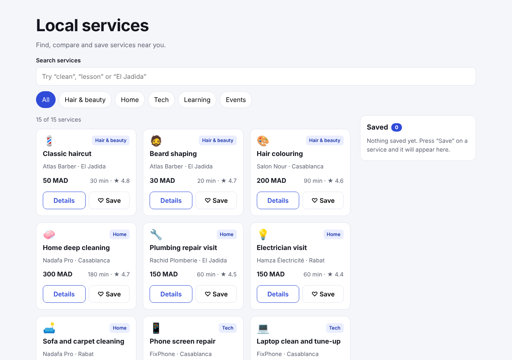
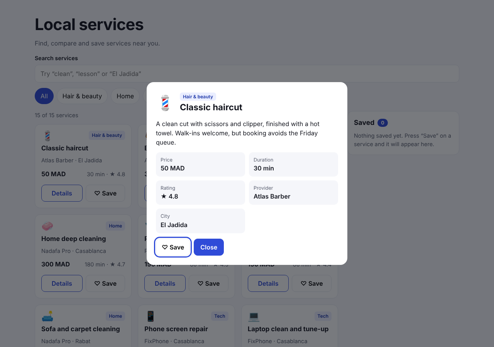
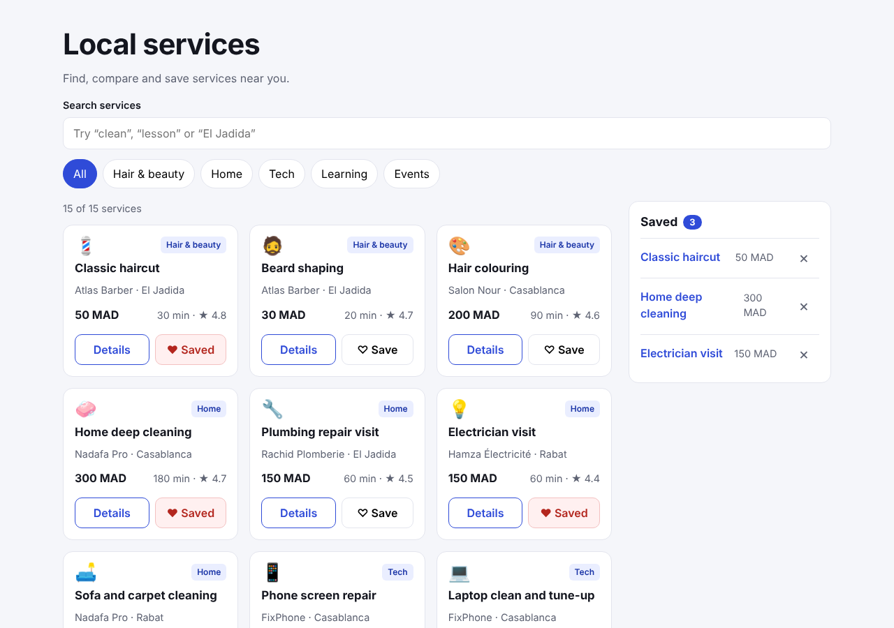
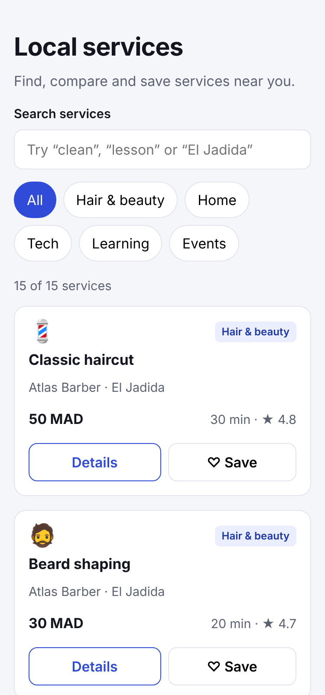

# Local services app

A React app built with Vite. It loads a list of services from a JSON file with `fetch`.
You can search, filter by category, open a details view and keep a list of saved services.

**Live link:** _add your deployed link here_

## Screenshots

| List | Details | Saved | Phone |
|---|---|---|---|
|  |  |  |  |

## Run it

```bash
npm install
npm run dev
```

Build for production with `npm run build`, and test the result with `npm run preview`.

## How it works

```
src/
  App.jsx                  state, search + filter logic, which screen to show
  hooks/
    useServices.js         fetch + loading / success / error + retry
    useLocalStorage.js     useState that is saved in localStorage
  components/
    SearchBar.jsx          props: value, onChange
    CategoryFilter.jsx     props: categories, active, onChange
    ServiceList.jsx        props: services, savedIds, onOpen, onToggleSave
    ServiceCard.jsx        props: service, isSaved, onOpen, onToggleSave
    ServiceDetails.jsx     props: service, isSaved, onToggleSave, onClose  (native <dialog>)
    SavedList.jsx          props: services, onOpen, onRemove
    StateMessage.jsx       props: type, title, text, actionLabel, onAction
public/services.json       the data
```

## Checklist

- [x] **Created with Vite, runs with `npm run dev`.**
- [x] **At least 4 components that receive props.** There are 7.
- [x] **Data loaded with `fetch`, with loading and error states.** `useServices` returns `status` (`loading`, `success`, `error`). It checks `response.ok`, cancels the request with `AbortController` and has a *Try again* button.
- [x] **Search and filter work together.** `visibleServices` keeps a service only if it matches the category **and** the search text.
- [x] **A details view opens and closes with the keyboard.** It is a native `<dialog>` opened with `showModal()`. `Enter` on *Details* opens it, `Escape` closes it, `Tab` stays inside and focus returns to the button.
- [x] **The saved list survives a refresh.** Saved ids are kept in `localStorage` through `useLocalStorage`.
- [x] **Responsive on a phone.** One column under 860px, no sideways scrolling, buttons at least 44px tall.
- [ ] **Deployed, with the live link and screenshots in the README.** Deploy it, then paste the link above.

## Deploy (Vercel)

1. Push the project to a GitHub repository.
2. On vercel.com choose **Add New → Project** and import the repository.
3. Vercel detects **Vite**. Press **Deploy**.
4. Check that the live site loads the data (`/services.json`).

## Test the states

- **Loading:** DevTools → Network → *Slow 3G*, refresh.
- **Error:** rename `public/services.json`, or choose *Offline*. Then press *Try again*.
- **Empty:** search for `zzzz`.
